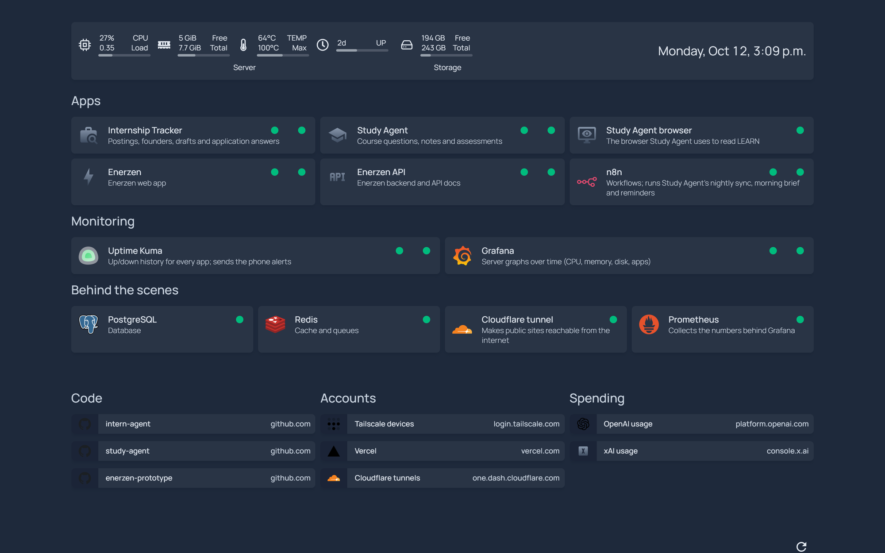

# Home dashboard

**One start page for my home server:** every app with a live up/down dot, 
server CPU, memory, disk and temperature, and links to the monitoring tools.

The server is a MacBook running Ubuntu on Tailscale.
It's [Homepage](https://gethomepage.dev) running in Docker, configured by the YAML files
in `config/`. It is only reachable over Tailscale:

**http://100.76.57.23**

## What's on it

- **Top:** live CPU, memory, CPU temperature, uptime and storage for the server.
- **Apps:** Internship Tracker, Study Agent (and its browser), Enerzen web and API, n8n.
- **Monitoring:** Uptime Kuma and Grafana.
- **Behind the scenes:** PostgreSQL, Redis, the Cloudflare tunnel and Prometheus.
- **Bookmarks:** GitHub repos, Tailscale, Vercel, Cloudflare, and OpenAI/xAI usage.

Each tile has a status dot (green when the app answers, with its response time) and,
underneath, its container's state, CPU and memory. Type anywhere on the page to search.

## Changing it

| To change | Edit |
|---|---|
| Tiles (add an app, rename, change a link) | `config/services.yaml` |
| The stats strip at the top | `config/widgets.yaml` |
| Bookmarks | `config/bookmarks.yaml` |
| Title, theme, columns | `config/settings.yaml` |

Then commit and push to `main`. The server checks GitHub every minute, pulls the new
commit and restarts the dashboard; a commit that breaks it is rolled back. Homepage
picks up config changes without a restart.
Icons: `mdi-<name>` from [Material Design Icons](https://pictogrammers.com/library/mdi/),
or `<app>.png` from [Dashboard Icons](https://dashboardicons.com).

## How it runs

- `compose.yaml` runs Homepage, published only on the Tailscale address
  (`100.76.57.23:80`), so nothing outside your tailnet can reach it.
- Homepage reads container status through `docker-proxy`, which allows only read-only
  container queries, so the dashboard can't start, stop or change anything.
- The server's folder is a clone of this repo, deployed by the same push-to-deploy
  cron as the other projects (you get a 🚀 push when it's live).
- Uptime Kuma checks it like the other apps, and the server alerts know its containers.

## Laptop backup

`laptop-backup/backup.sh` (run from Git Bash on the laptop) copies `Documents/Projects`
and Notepad's open tabs to the server, under `~/backups/laptop/`. Upside Robotics work
isn't copied: the folders in `laptop-backup/not-backed-up.txt`, and Notepad notes that
mention Upside work or open files from those folders. Folders that are rebuilt from the
project files (`node_modules`, Python environments, caches) are skipped too.
